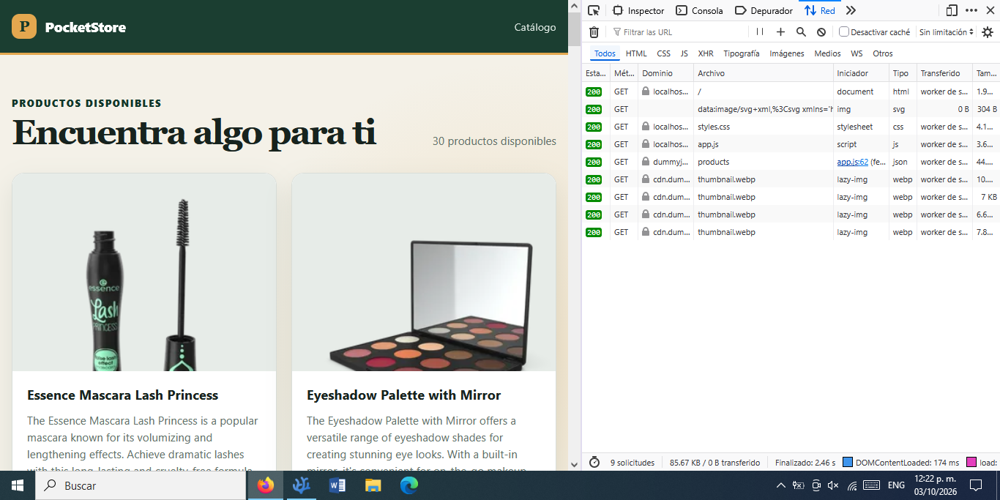
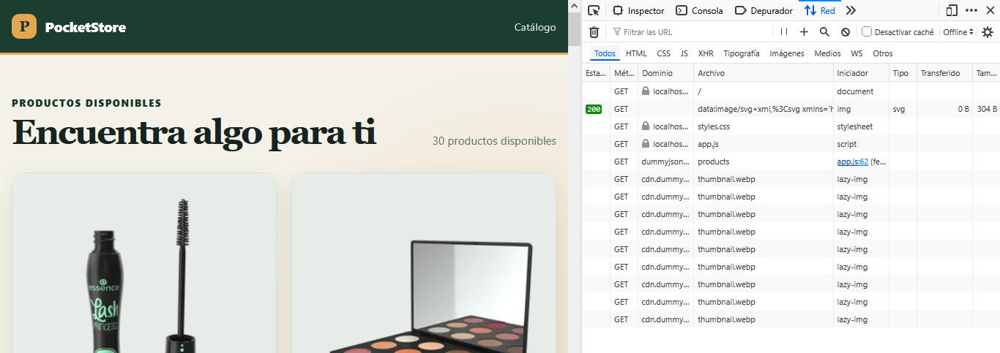

# PocketStore

PocketStore es una aplicación web de una sola página que consulta y presenta un catálogo de productos. Después de una primera visita con conexión, su interfaz y los datos consultados quedan disponibles para volver a cargar la aplicación sin Internet.

## Objetivo

Demostrar los fundamentos de una Progressive Web App (PWA) sencilla: contenido dinámico, Web App Manifest, App Shell y almacenamiento en caché mediante un Service Worker, utilizando únicamente tecnologías web nativas.

## Tecnologías utilizadas

- HTML5 semántico.
- CSS3 responsive.
- JavaScript Vanilla.
- Fetch API para consultar DummyJSON Products.
- Cache API y Service Workers para el funcionamiento offline.
- Web App Manifest para describir la aplicación instalable.

No requiere frameworks, librerías externas, npm, backend ni claves de API.

## Estructura de archivos

```text
pocket-store/
├── index.html       # Estructura de la interfaz
├── styles.css       # Diseño responsive
├── app.js           # Consulta de productos y creación de tarjetas
├── sw.js            # Service Worker y estrategias de caché
├── manifest.json    # Configuración de la aplicación web
├── README.md        # Documentación del proyecto
└── images/          # Evidencias y capturas del desarrollo
```

## App Shell

El App Shell es la estructura mínima necesaria para mostrar la aplicación: `index.html`, `styles.css`, `app.js` y `manifest.json`. Estos recursos se guardan durante la instalación del Service Worker, por lo que la barra superior, el contenedor principal, el estado de carga y el pie de página pueden mostrarse sin conexión.

## Web App Manifest

`manifest.json` define el nombre de PocketStore, su nombre corto, colores, idioma y modo de visualización `standalone`. Las rutas `start_url` y `scope` usan `./` para funcionar tanto en un servidor local como dentro de la subcarpeta de un repositorio publicado con GitHub Pages.

El proyecto no incluye archivos de icono de 192 × 192 ni 512 × 512, por lo que el manifest no contiene rutas inexistentes. Para añadirlos después:

1. Guarda, por ejemplo, `icon-192.png` e `icon-512.png` en una carpeta de recursos del proyecto.
2. Agrega al manifest una propiedad `icons` con las rutas relativas, tamaños (`192x192` y `512x512`) y el tipo `image/png`.
3. Verifica desde DevTools que ambos archivos se carguen sin errores.

## Service Worker

El archivo `sw.js` utiliza cachés versionadas y gestiona tres eventos:

- `install`: abre `pocket-store-v1` y guarda todos los archivos del App Shell.
- `activate`: elimina cachés antiguas cuyo nombre pertenece a PocketStore y conserva solamente las versiones actuales.
- `fetch`: ignora métodos distintos de `GET` y elige una estrategia según el recurso solicitado.

### Estrategia de caché

- **App Shell — cache first:** responde primero desde caché. Si el recurso todavía no existe, lo solicita a la red y lo guarda. Una navegación sin conexión puede usar `index.html` como respaldo.
- **API — network first:** intenta obtener datos actuales desde `https://dummyjson.com/products`. Una respuesta exitosa se guarda en `pocket-store-data-v1`; si la red falla, se entrega la última respuesta guardada.
- **Imágenes — cache first:** las imágenes de productos que el navegador haya solicitado se guardan en `pocket-store-images-v1` y pueden reutilizarse offline.

## Funcionamiento offline

La primera visita debe realizarse con Internet para instalar el Service Worker, guardar el App Shell y consultar los productos. En visitas posteriores, el navegador puede reconstruir la interfaz desde caché. `app.js` vuelve a solicitar los productos y, si no hay red, el Service Worker responde con los datos de la última consulta exitosa.

Las imágenes usan carga diferida; por ello, una imagen estará disponible offline después de haberse cargado al menos una vez en pantalla.

## Cómo ejecutar el proyecto

Los Service Workers requieren un contexto seguro. `localhost` se considera seguro, pero abrir `index.html` directamente con `file://` no es suficiente.

Desde la carpeta `pocket-store`, inicia un servidor HTTP local con:

```bash
npx serve .
```

Luego visita:

```text
http://localhost:3000/
```

`npx` se utiliza únicamente para ejecutar el servidor local; PocketStore no tiene dependencias npm.

## Cómo probar el modo offline con DevTools

1. Abre la aplicación con Internet y espera hasta que aparezcan los 30 productos.
2. Comprueba que el Service Worker esté registrado y activo desde las herramientas de desarrollo. También puedes ejecutar `navigator.serviceWorker.getRegistration().then(console.log)` en la consola.
3. Revisa **Cache Storage** y confirma que existan las cachés `pocket-store-v1`, `pocket-store-data-v1` y `pocket-store-images-v1`. También puedes ejecutar `caches.keys().then(console.log)` en la consola.
4. En Firefox DevTools, abre la pestaña **Network** (o **Red**) y selecciona **Offline**.
5. Recarga la página. La interfaz y los productos deben aparecer sin conexión.
6. Desactiva el modo **Offline** al terminar la prueba.

Si se cambia `sw.js` o un archivo estático, conviene aumentar la versión de sus cachés para que la activación elimine las anteriores.

## Publicación básica en GitHub Pages

1. Sube el contenido de `pocket-store` a un repositorio de GitHub. Si esta carpeta queda dentro de un repositorio mayor, configura Pages para que la carpeta publicada contenga directamente `index.html`.
2. En GitHub, abre **Settings > Pages**.
3. En **Build and deployment**, selecciona **Deploy from a branch**.
4. Elige la rama correspondiente (por ejemplo, `main`) y la carpeta publicada disponible, y guarda la configuración.
5. Abre la URL que GitHub indique, realiza una primera visita con Internet y comprueba el Service Worker desde DevTools.

Todas las rutas de la aplicación son relativas, de modo que conservan la subruta del repositorio en GitHub Pages.

## Pruebas realizadas

Las pruebas manuales se realizaron con PocketStore servido desde `http://localhost:3000/`. Se verificó correctamente:

- La carga normal del catálogo con conexión a Internet.
- La presentación de los 30 productos obtenidos desde DummyJSON, con sus imágenes, títulos, descripciones y precios.
- El registro y la activación del Service Worker con el alcance `http://localhost:3000/`.
- La creación de Cache Storage y de las tres cachés esperadas: `pocket-store-v1`, `pocket-store-data-v1` y `pocket-store-images-v1`.
- La carga offline del App Shell después de activar el modo **Offline** de Firefox DevTools y recargar la página.
- La disponibilidad offline de los datos de los 30 productos.
- La disponibilidad offline de las imágenes que se habían cargado durante la visita con conexión.
- La ausencia de errores en la consola durante la prueba con conexión.

## Evidencias del desarrollo



La captura muestra el catálogo cargado correctamente con los productos obtenidos desde la API de DummyJSON.



La captura muestra PocketStore funcionando después de activar el modo **Offline** de Firefox DevTools y recargar la aplicación.
